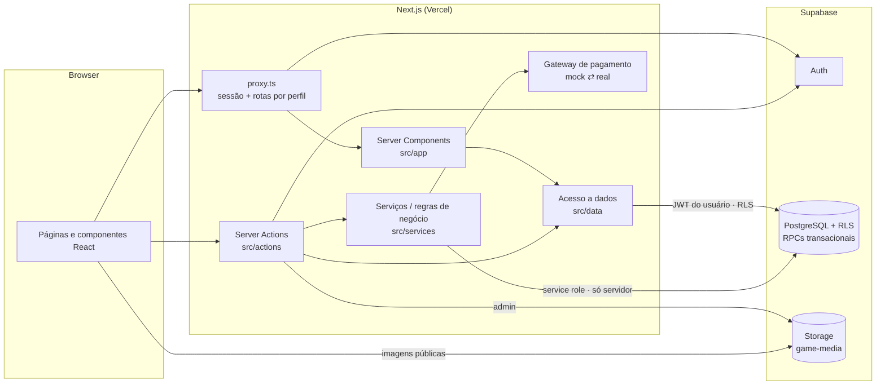
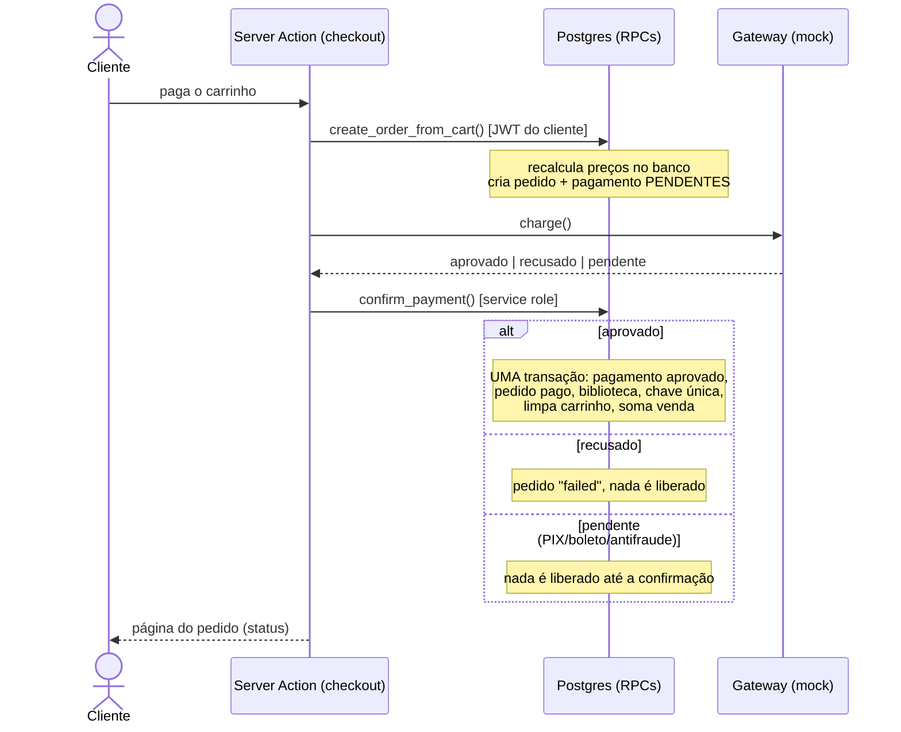
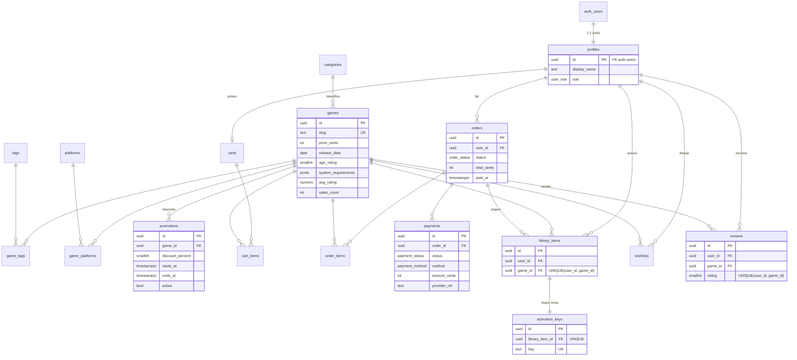

# GameZone Brasil — loja digital de games

Loja online para uma loja local de games que hoje vende jogos em pen drives e game sticks de TV e quer escalar para a internet.
O cliente compra, o pagamento é confirmado e o jogo cai **na hora** na biblioteca dele, com uma **chave de ativação única** e botão de download.

- **Stack:** Next.js 16 (App Router) + TypeScript + Tailwind CSS 4 · Supabase (PostgreSQL, Auth, Storage) · Zod · Vitest · Playwright · Vercel
- **Pagamento:** gateway **simulado** (aprova, recusa ou deixa pendente), com interface pronta para trocar por um gateway real.
- **Conteúdo:** 41 jogos 100% fictícios (nomes, estúdios, capas e banners SVG originais).

## Identidade visual

Inspiração: catálogo/biblioteca no estilo de lojas de PC + escolha facilitada de streaming (hero, carrosséis, cards que expandem no hover). Nenhum nome, logo ou cor de marca de terceiros foi usado.

Três opções de nome consideradas:

| Opção | Ideia |
|---|---|
| **GameZone Brasil** (atual) | Nome direto e divertido; logo: um controle de videogame sorridente com faísca verde-limão e selo "BRASIL". |
| PixelPorto (versão anterior) | "Porto" remete a embarque/chegada; logo em pixels com vela de barco. |
| Cartucho&Co | Nostalgia do cartucho, tom de loja de bairro. |
| NuvemPlay | Foco em entrega digital/streaming. |

Tema escuro em **vermelho escuro** (`#14070a`, `#1f0b10`) com **verde-limão** (`#a3e635`) como cor de ação e destaques. Cada jogo tem capa própria (paleta, fundo e personagem ilustrado) gerada por `scripts/art.mjs`. Acessibilidade: contraste alto, foco visível, link "Pular para o conteúdo", `aria-label`s, textos alternativos nas capas, formulários com rótulos e erros anunciados (`role="alert"`), `prefers-reduced-motion` respeitado e carrossel pausável (hover/foco).

## Arquitetura



Camadas e pastas:

```
src/
  app/            UI: rotas (páginas, route handlers, layouts)
  components/     UI: componentes reutilizáveis
  actions/        Server Actions (entrada de formulários; validam com Zod)
  services/       Regras de negócio: preço, checkout, gateway, estatísticas
  data/           Acesso a dados (consultas ao Supabase)
  lib/            Clientes Supabase, validação (Zod), erros amigáveis, rotas, formatação
  types/          database.ts (tipos gerados do banco)
  proxy.ts        "Middleware" do Next 16: renova sessão e protege rotas por perfil
supabase/
  migrations/     schema, funções/RPCs, RLS, storage
  seed.sql        dados de exemplo (gerado)  ·  seed-assets/  SVGs das capas
scripts/          generate-seed, upload-covers, gen-types
tests/            unit (Vitest) e db (Vitest + Postgres WASM)   ·   e2e/  Playwright
```

### Fluxo de compra e liberação automática



Garantias:

- `confirm_payment` é a **única** porta que libera jogo. Só o `service_role` pode executá-la (`REVOKE` para `anon`/`authenticated`) e nenhum cliente tem permissão de `INSERT` em `orders`, `payments`, `library_items` ou `activation_keys`.
- Preços vêm do banco (view `catalog_games` + promoções vigentes), nunca do navegador. A RPC confere se `payment.amount == order.total == soma dos itens`.
- Confirmar duas vezes é idempotente (não duplica biblioteca nem chave); pagamento recusado/cancelado não pode ser "ressuscitado".
- A `SUPABASE_SERVICE_ROLE_KEY` só é lida em `src/lib/supabase/admin.ts` (`import "server-only"`), nunca vai para o navegador.

## Modelo de dados



Constraints e índices relevantes: preços ≥ 0, desconto 1–95%, `ends_at > starts_at`, `UNIQUE(user_id, game_id)` na biblioteca, 1 pagamento aprovado por pedido (índice único parcial), `CHECK (status='paid') = (paid_at is not null)`, índices por categoria, preço, lançamento, vendas e pedidos do usuário.
`catalog_games` é uma view (`security_invoker`) que une jogo, categoria, preço final com promoção, tags e plataformas.

### Políticas RLS (todas as tabelas têm RLS ligada)

| Tabela | Visitante | Cliente | Admin |
|---|---|---|---|
| categories, tags, platforms, game_tags, game_platforms, promotions | leitura | leitura | CRUD |
| games | leitura (apenas ativos) | leitura | CRUD (inclusive inativos) |
| profiles | — | lê/edita o próprio (não altera `role`, via trigger) | lê todos |
| carts, cart_items, wishlists | — | CRUD só do dono | — |
| orders, order_items, payments | — | lê os próprios (escrita só via RPC) | lê todos |
| library_items, activation_keys | — | lê os próprios | lê todos |
| reviews | leitura | cria/edita **somente se comprou o jogo** (`library_items`), apaga as próprias | apaga qualquer |
| storage `game-media` | leitura pública | — | upload/edição/remoção |

## Home 3D de rolagem (branch `feat/redesign-3d`)

A página inicial (`/`) é uma experiência de rolagem com **6 jogos em destaque** (Gravitron GP, Fazenda Lua Nova, Marés de Guerra, Casa dos Espelhos Cegos, A Trilha dos Vagalumes, Rali das Dunas Vermelhas). Cada um ocupa a tela inteira: cena 3D à esquerda, título, gêneros, descrição, preço e **COMPRAR** à direita. Depois dos seis, um carrossel estilo Netflix leva aos demais; a loja clássica continua em `/loja`.

- Stack: React Three Fiber + drei + postprocessing, GSAP ScrollTrigger + Lenis; um único `<Canvas>` fixo, carregado sob demanda.
- Tudo é procedural (sem arquivos 3D externos; ver [docs/CREDITOS.md](docs/CREDITOS.md)). Os jogos vêm do mesmo catálogo (Supabase ou modo estático); a lista e a ordem estão em `src/config/featured.ts`.
- Fallbacks: sem WebGL ou com `prefers-reduced-motion` aparecem seções planas com a arte do jogo. `?q=low` / `?q=high` força a qualidade.
- Documentos: [auditoria](docs/AUDITORIA.md), [storyboard](docs/STORYBOARD.md), [performance](docs/PERFORMANCE.md).
- Agentes de apoio em `.claude/agents/`.

Limitações honestas: visual estilizado (não fotorrealista); FPS/Lighthouse reais não medidos (só havia WebGL por software); em modo estático COMPRAR leva à página do jogo, e a compra que registra pedido exige Supabase configurado (não verificada aqui).

## Entrega parcial: pré-visualização sem banco (modo estático)

Sem nenhuma variável de ambiente, o site roda em **modo estático**: usa os 41 jogos, avaliações e capas SVG embutidos no projeto (`src/data/static/catalog.json` e `public/media`), sem Supabase. Home 3D, loja, catálogo com busca/filtros/ordenação e páginas dos jogos funcionam, e o **fluxo de compra roda de ponta a ponta no navegador** (carrinho, desejos, pagamento simulado com aprovado/recusado/pendente, biblioteca com chave de ativação e download, pedidos), salvo no `localStorage` (`src/lib/local-store.ts`). Só contas de usuário e painel admin ficam para a versão com Supabase e levam a uma página "faz parte da versão completa".

- Ativa sozinho quando `NEXT_PUBLIC_SUPABASE_URL` não existe (ou com `NEXT_PUBLIC_STATIC_MODE=true`).
- **Publicar na Vercel sem configurar nada:** `npx vercel login` e depois `npx vercel --prod`; ou suba para o GitHub e importe o repositório na Vercel (Framework: Next.js, sem variáveis).
- Para ligar a versão completa, defina as variáveis do Supabase (seção abaixo) e o site passa a usar o banco.
- Os arquivos estáticos são regerados por `npm run db:seed:generate`.

## Modo demonstração (sem login)

Com `DEMO_MODE=true` (padrão do `.env.example`) o site **abre direto, sem tela de login/cadastro**:

- O `proxy.ts` faz o login no servidor com o usuário **Jogador Demo** (`demo@pixelporto.test`, criado pelo seed) e grava a sessão em cookie. É uma sessão **real** do Supabase Auth: a RLS continua valendo exatamente como antes, e o jogo continua só sendo liberado por `confirm_payment` após pagamento aprovado.
- O cabeçalho mostra o nome e o avatar do usuário demo, com biblioteca, pedidos e desejos. Carrinho, checkout, biblioteca, histórico e lista de desejos funcionam sem login.
- O seletor **Modo admin** (no cabeçalho, só no modo demo) troca a sessão para `admin@pixelporto.test` e leva a `/admin`. Acessar `/admin` como cliente mostra uma página que oferece ativar o Modo admin.
- `/entrar`, `/cadastro` e `/recuperar-senha` redirecionam para a home.
- Com `DEMO_MODE=false` (ou ausente) tudo volta ao modelo normal com login, cadastro, recuperação de senha e rotas protegidas por perfil.

> Nunca publique com clientes reais usando `DEMO_MODE=true`: qualquer visitante poderia ativar o Modo admin.

## Passo a passo

### 1) Criar o projeto no Supabase (nuvem)

1. Em <https://supabase.com/dashboard> crie um projeto e guarde a senha do banco.
2. **Project Settings → API**: copie `Project URL`, `anon public key` e `service_role key`.
3. **Authentication → Providers → Email**: desligue **Confirm email** (para o cadastro já entrar logado na demonstração; com ele ligado, o cliente precisa clicar no e-mail).
4. **Authentication → URL Configuration**: `Site URL` = `http://localhost:3000` (depois a URL da Vercel) e adicione em *Redirect URLs* `http://localhost:3000/auth/callback` e `https://SEU-APP.vercel.app/auth/callback`.
5. Instale as dependências e aplique migrations + seed:

```bash
npm install
npx supabase login
npx supabase link --project-ref SEU_PROJECT_REF
npx supabase db push --include-seed      # aplica supabase/migrations e supabase/seed.sql
```

   (Alternativa sem CLI: cole os 4 arquivos de `supabase/migrations` e depois `supabase/seed.sql` no **SQL Editor**, nesta ordem.)

6. Configure o ambiente, envie as capas ao Storage e **confira tudo com o diagnóstico**:

```bash
cp .env.example .env.local     # no Windows: copy .env.example .env.local
# preencha NEXT_PUBLIC_SUPABASE_URL, NEXT_PUBLIC_SUPABASE_ANON_KEY e SUPABASE_SERVICE_ROLE_KEY
npm run db:covers              # envia 205 SVGs ao bucket público game-media
npm run doctor                 # confere variáveis, conexão, contagens, RLS pública, Storage e usuários demo
```

### 1b) Alternativa: Supabase local (requer Docker)

```bash
npx supabase start       # sobe Postgres, Auth e Storage locais
npx supabase db reset    # aplica migrations + seed
npx supabase status      # mostra API URL, anon key e service_role key -> .env.local
npm run db:covers
```

### Rodar o seed de novo (banco resetado ou dados bagunçados)

O `supabase/seed.sql` é **re-executável**: ele começa apagando o catálogo (jogos, categorias, tags, plataformas e o que depende deles) e os usuários `@pixelporto.test`, e recria tudo. Escolha uma opção:

- **SQL Editor (mais simples):** abra `supabase/seed.sql`, cole no SQL Editor do Supabase e execute.
- **CLI, só o seed:** `npx supabase db push --include-seed` (aplica migrations pendentes + seed).
- **Banco local (Docker):** `npx supabase db reset`.
- **Resetar o banco remoto inteiro (apaga tudo!):** `npx supabase db reset --linked`.

Depois: `npm run db:covers` (as imagens ficam no Storage, mas reenviar é seguro: usa upsert) e `npm run doctor`. Se mudar `scripts/games-data.mjs`, rode antes `npm run db:seed:generate`.
As promoções do seed duram 30 dias a partir da execução; para renová-las, rode o seed de novo.

### 2) Rodar localmente

```bash
npm install
npm run dev              # http://localhost:3000
npm run build && npm start
```

Se a home mostrar um aviso em vez dos jogos, a mensagem diz o que falta (variáveis, conexão, migrations, seed ou RLS); rode `npm run doctor` para o diagnóstico completo.

Scripts úteis: `npm run db:seed:generate` (regera `seed.sql` e os SVGs) · `npm run db:types` (regera `src/types/database.ts` a partir das migrations; com Docker você também pode usar `npx supabase gen types typescript --local`).

### 3) Publicar na Vercel

1. Suba o projeto para um repositório no GitHub (`git init`, `git add .`, `git commit`, `git push`).
2. Na Vercel: **Add New → Project →** importe o repositório (framework Next.js é detectado sozinho).
3. Em **Environment Variables** cadastre:

| Variável | Valor | Observação |
|---|---|---|
| `NEXT_PUBLIC_SUPABASE_URL` | URL do projeto | pública |
| `NEXT_PUBLIC_SUPABASE_ANON_KEY` | anon key | pública (protegida por RLS) |
| `SUPABASE_SERVICE_ROLE_KEY` | service role key | **segredo**, só servidor — nunca com prefixo `NEXT_PUBLIC_` |
| `DEMO_MODE` | `true` para apresentação, `false` com clientes reais | ver "Modo demonstração" |
| `NEXT_PUBLIC_SITE_URL` | `https://SEU-APP.vercel.app` | usada nos links de e-mail |

4. Deploy. Depois adicione a URL da Vercel em **Authentication → URL Configuration** (Site URL e Redirect URLs).

## Credenciais de teste (criadas pelo seed)

| Perfil | E-mail | Senha | Situação |
|---|---|---|---|
| Demo (automático) | `demo@pixelporto.test` | `Demo@123456` | usado no modo demo: 3 jogos na biblioteca, 3 desejos |
| Admin | `admin@pixelporto.test` | `Admin@123456` | painel em `/admin` (no modo demo: seletor "Modo admin") |
| Cliente | `ana@pixelporto.test` | `Cliente@123456` | 5 jogos na biblioteca (2 pedidos pagos) |
| Cliente | `bruno@pixelporto.test` | `Cliente@123456` | 3 jogos; 1 pedido **recusado** |
| Cliente | `carla@pixelporto.test` | `Cliente@123456` | 2 jogos; 1 pedido de boleto **pendente** |

Os 10 usuários `avaliadorN@pixelporto.test` existem só para as avaliações fictícias.

**Cartões de teste do gateway simulado** (qualquer nome, validade futura e CVV de 3 dígitos; o número precisa passar na validação de Luhn):

| Número | Resultado |
|---|---|
| `4242 4242 4242 4242` (ou qualquer outro válido) | aprovado |
| `4000 0000 0000 0002` | recusado (emissor) |
| `4000 0000 0000 0051` | recusado (saldo insuficiente) |
| `4000 0000 0000 0003` | pendente (antifraude) |

PIX e boleto ficam **pendentes**; na página do pedido use "Simular pagamento aprovado/recusado" (simula o webhook do gateway).

## Roteiro de demonstração: escolher jogo → compra → biblioteca

1. Abra `/`: já entra como **Jogador Demo**. Mostre o hero, os carrosséis (Em alta, Lançamentos, Promoções, *Porque você jogou Crônicas de Valdoran*, Grátis) e o hover dos cards (preço, desconto, tags, comprar e desejos).
2. Em `/catalogo` busque "arena", filtre por gênero/plataforma/faixa de preço/classificação e ordene.
3. Abra um jogo (ex.: *Turbo Quartzo*): galeria, requisitos, avaliações. O formulário de avaliação não aparece (não comprou).
4. **Comprar agora → Ir para o pagamento** e pague com `4242 4242 4242 4242`.
5. A página do pedido mostra **Pagamento aprovado**. Em **Minha biblioteca** o jogo está lá com a **chave de ativação** (Mostrar/Copiar) e o botão **Baixar**.
6. Em **Meus pedidos** veja o status do pagamento. Volte ao jogo e **avalie** (agora é permitido).
7. Repita com `4000 0000 0000 0002` (recusa: nada é liberado) e com PIX (pendente → "Simular pagamento aprovado").
8. Ative o **Modo admin** no cabeçalho: em `/admin` veja indicadores, crie um jogo com upload de capa, uma categoria e uma promoção, e confira os pedidos.

## Testes

```bash
npm test                 # Vitest: regras de negócio + banco (migrations, seed, RLS, RPCs)
npm run test:e2e         # Playwright: fluxo de compra (precisa do Supabase configurado, seed aplicado e DEMO_MODE=true)
npx playwright install chromium   # uma vez, antes do e2e
```

- `tests/unit`: preço/desconto, gateway simulado, orquestração do checkout, validações Zod, proteção de rotas, anti open-redirect, mensagens de erro.
- `tests/db`: aplica as migrations e o seed (inclusive reexecutando-o) num **Postgres real em WASM (PGlite)** com stubs de `auth`/`storage` e verifica RLS por perfil, avaliações só para compradores, `confirm_payment` (aprovado, recusado, pendente, idempotência, valor divergente, gratuito) e chaves únicas.
- `e2e/purchase.spec.ts` (modo demo): home sem login e com carrosséis, escolher jogo → carrinho → pagar → biblioteca com chave → download, cartão recusado, lista de desejos e Modo admin.

## Limitações conhecidas

- **Gateway simulado:** nenhum dinheiro é movimentado. Para produção, implemente `PaymentGateway` (`src/services/gateway/types.ts`) e registre em `services/gateway/index.ts`; o pagamento real deve confirmar via webhook assinado chamando `confirm_payment`.
- **Download simulado:** entrega um `.txt`; arquivos reais exigiriam um bucket privado com URLs assinadas.
- **Chaves de ativação** são geradas pelo banco; não há integração com um sistema de licenças.
- Os testes de banco rodam em PGlite, não no Postgres/GoTrue do Supabase; o e2e do Playwright só roda com um projeto Supabase real.
- Sem Docker, `supabase gen types` não roda; por isso `npm run db:types` gera o mesmo formato a partir das migrations.
